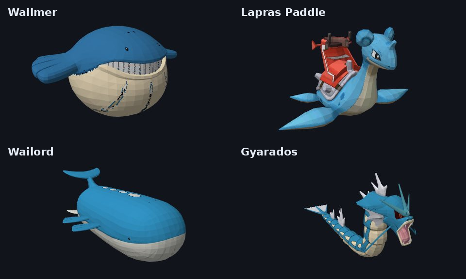
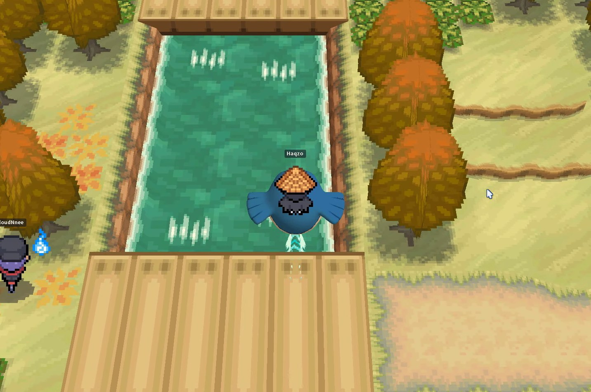
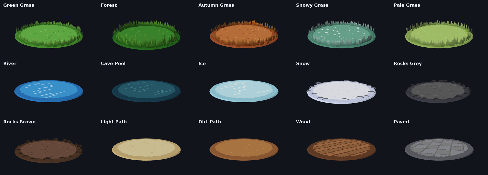
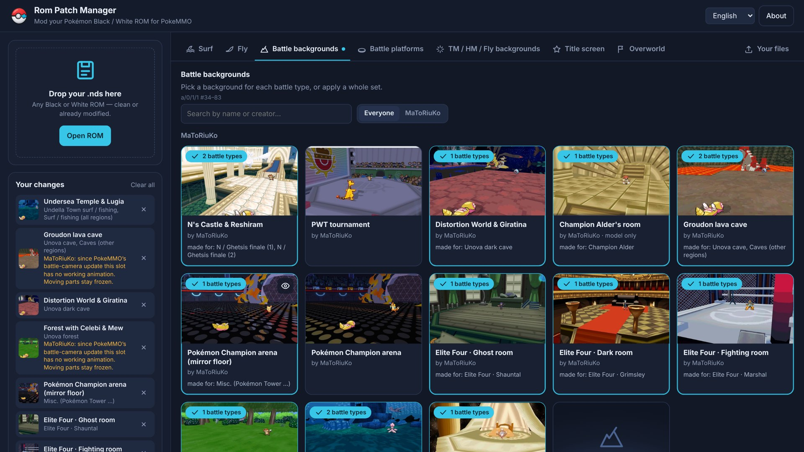
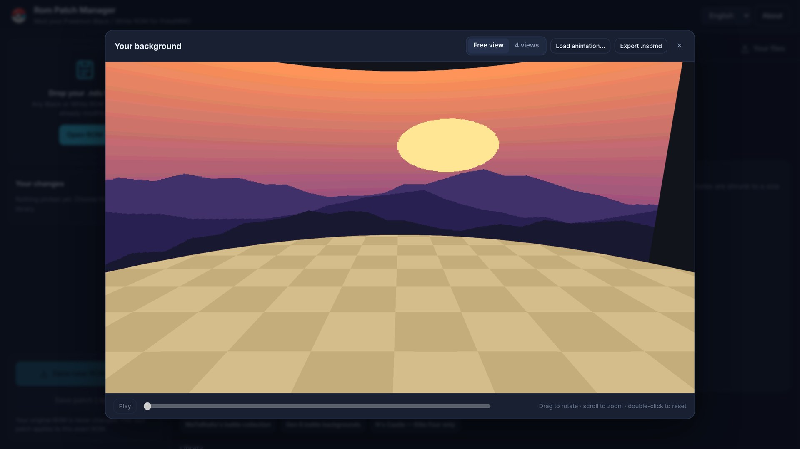

# Rom Patch Manager 1.1.0 — New Surf models, Pixel battle grounds, Make-your-own backgrounds & Map packs ✨

**Four new Surf rides, MaToRiuKo's new battle backgrounds for the current game version, a full set of pixel-art battle grounds, his battle-background templates and map packages, a library filter, and a dev mode.**

**Use it:** https://haqzo.github.io/Rom-Patch-Manager/ — nothing to install. Already used it? Press **Ctrl + Shift + R** once.

## What's new

### 🌊 New Surf models (by Haqzo)
- **Wailmer**, **Wailord** and **Gyarados** from Pokémon X/Y, and **Lapras Paddle** — the Sun/Moon Poké Ride Lapras with its saddle.
- All four are tested in PokeMMO.
- Made with the new model pipeline (`tools/model-pipeline/model2surf.py` → CTRMap-CE). How-to: [docs/custom-models.md](https://github.com/haqzo/Rom-Patch-Manager/blob/main/docs/custom-models.md).

### 🌱 Pixel battle grounds (set)
- 15 pixel-art grounds with real 3D grass blades, rocks and snow lumps.
- One pick fills all 34 platform slots, and every battle location gets its own ground: grass, tall grass, autumn and winter grass, water, deep water, ice, snow, caves, sand, dirt, bridges, buildings.
- Same size as Black/White's own discs. The first (smooth) disc test worked in PokeMMO; screenshots of the pixel set in different places are very welcome.

### ⛰️ New battle backgrounds (by MaToRiuKo)
- MaToRiuKo's battle backgrounds rebuilt for the current game version — the older ones were offset and are gone.
- 13 scenes: the four **Elite Four rooms** (Ghost, Dark, Fighting, Psychic), **Champion Alder's room**, **N's Castle & Reshiram**, **Distortion World & Giratina**, **Groudon lava cave**, **Forest with Celebi & Mew**, **Undersea Temple & Lugia**, the **Pokémon Champion arena** (with or without mirror floor) and the **PWT**.
- **MaToRiuKo's collection** puts them all on their battle types in one click. Nyan Cat also gets its rainbow water splash.

### 🖼️ Make your own battle background from pictures (by MaToRiuKo)
- Ported from MaToRiuKo's romtool 1.2.24. Pick battle types, pick a template — *floor + backdrop* or *one full picture* — choose pictures, preview in 3D, add.
- Only the textures change; the 3D model stays exactly as MaToRiuKo built it. 16 or 256 colours (index 0 is transparent, as on the DS).
- Pictures are shrunk to a size the template accepts (never enlarged). The full-picture template is about 1 MB per battle type.

### 🗺️ Map textures (by MaToRiuKo)
- **Your files → Map textures:** drop one area `.BTX0` — the area number is read from the file name, with all 282 areas named — or drop a whole map pack `.narc` and press **Replace the whole archive**.
- Entries that keep their size or shrink are written in place, so `.bps` patches stay small.

### 🔎 Library filter
- Search by name or creator, plus creator buttons, on every library tab and in battle backgrounds.

### 🛠️ Dev mode
- Add `?dev` to the address: *My items* (saved in your browser), `.rpmpack` packs to share, and a battle-platform builder with one model per slot. `?dev=off` turns it off.

### Fixes
- Updates show up on a normal reload (the offline helper always checks the server).
- Archives from MaToRiuKo's romtool, whose GMIF size leaves out its header, now open.

## Known limits
- Template backgrounds and map packs pass MaToRiuKo's checks and real-ROM builds, but haven't been played in PokeMMO by us yet — feedback welcome.
- Map area names are MaToRiuKo's; the 72 indoor/cave areas are only described in Chinese.
- Lots of big changes add up: watch the size meter (~10 MB of extra data is where MaToRiuKo saw loading problems).

## Credits
**MaToRiuKo** — models, battle backgrounds, templates, map packages and the original romtool. **Haqzo** — the tool, the new Surf models and the pixel battle grounds. **CTRMap-CE** by HelloOO7 and contributors. Source models via The Models Resource; Pokémon © Nintendo / Game Freak / The Pokémon Company.

No ROMs are included or distributed. Full changelog: [CHANGELOG.md](https://github.com/haqzo/Rom-Patch-Manager/blob/main/CHANGELOG.md)
