# Rom Patch Manager

**Open your ROM → pick what you want → preview it → save a new `.nds` or a `.bps`.**

A browser tool for modding Pokémon Black / White ROMs for PokeMMO, made by **Haqzo & MaToRiuKo**.
UI in English, 简体中文 and Español. Works on Windows, Linux and Mac. Your ROM never leaves your computer:
everything runs inside the browser.

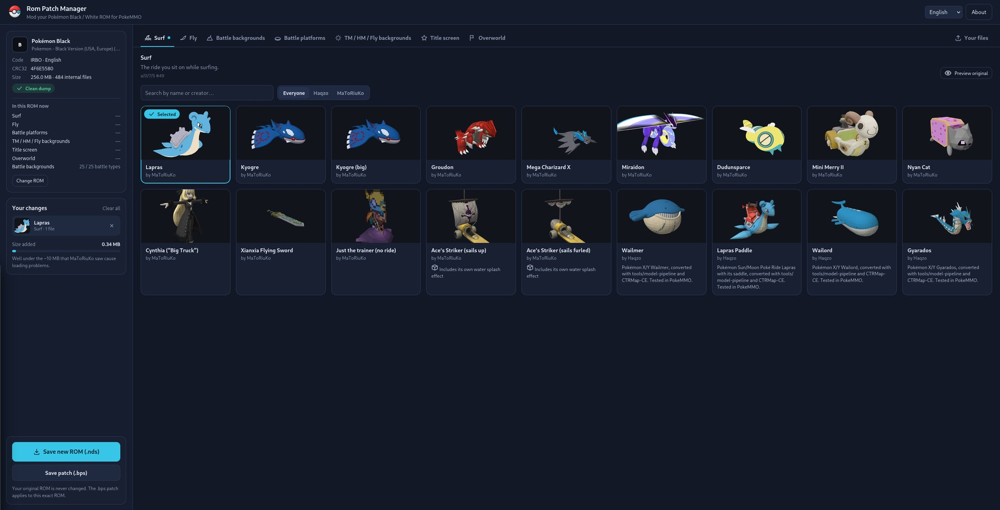

## Use it

**Open https://haqzo.github.io/Rom-Patch-Manager/** — that's it. Your ROM stays on your computer; the site only
delivers the tool and its model library.

1. **Open ROM** — any Pokémon Black or White `.nds`, clean or already modified, any language.
2. **Pick** what you want from the tabs (Surf, Fly, Battle backgrounds, Battle platforms …) or drop your own files.
3. **Preview** in 3D, and compare with what's in your ROM.
4. **Save new ROM (.nds)** or **Save patch (.bps)**. Your original ROM is never changed.

- **Chrome / Edge:** click **Install app** (top right, or the install icon in the address bar). It becomes a normal
  app with its own icon. It works offline and updates itself.
- **Firefox:** bookmark it or pin the tab.
- **Already used it before?** Press **Ctrl + Shift + R** once after an update.

**Offline without the website:** download the source (`Code → Download ZIP`) and run
`Rom Patch Manager.bat` (Windows) or `./start.sh` (Linux / Mac). Needs Python 3.

No ROMs are included or distributed — you need your own.

## What's in it

| | |
|---|---|
| **Surf** | 17 models — MaToRiuKo's collection plus Haqzo's new Wailmer, Lapras Paddle (with saddle), Wailord and Gyarados (all four tested in PokeMMO) |
| **Fly** | Complete take-off + landing sets (models and animations always installed together), incl. Legendary Fly — Rayquaza |
| **Battle backgrounds** | MaToRiuKo's 13 scenes made for the current game version (Elite Four rooms, N's Castle, Distortion World, Groudon lava cave, PWT …), YOKA's Blue PVP Battle Field, MaToRiuKo's complete set, and **make your own from pictures** |
| **Battle platforms** | **Pixel battle grounds (set)** — 15 grounds, each battle location gets its own — plus transparent / no platforms |
| **TM / HM / Fly backgrounds, Title screen, Overworld** | Clean backgrounds, title-screen showcases, monuments |
| **Your files** | Your own `.nsbmd` / `.nsbca` on Surf, a battle type, all platforms, Fly or any archive entry; **map textures** (one area `.BTX0` or a whole map pack `.narc`) |

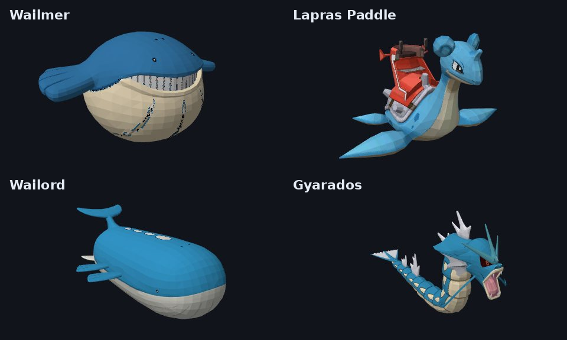

### New in 1.1.0

**Pixel battle grounds** — 15 pixel-art grounds with real 3D grass, rocks and snow. The set puts the right ground
in each of the 34 platform slots: grass on grass routes, water on water, autumn and winter versions for the seasons,
caves, snow, sand, bridges, buildings …

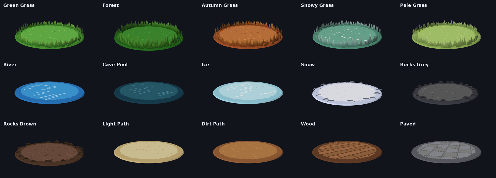

**Make your own battle background from pictures** (MaToRiuKo's template swap, from his romtool 1.2.24).
Pick battle types, pick a template (*floor + backdrop* or *one full picture*), choose your pictures, preview, add.
Only the textures change; the 3D model stays exactly as MaToRiuKo built it.

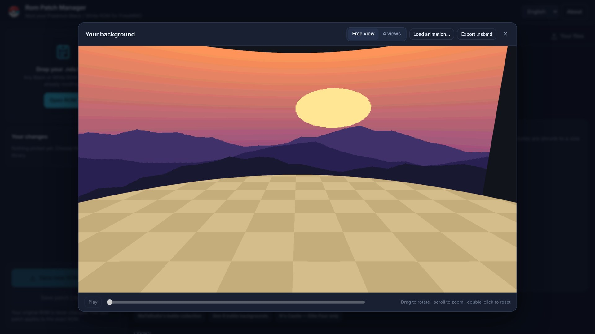

**Map textures** (MaToRiuKo's map packages, a/0/1/4). Drop a single area `.BTX0` — the area number is read from the
file name (`…_4_62_VillageBridge.BTX0` → #62 Village Bridge, 282 named areas) — or a whole map pack `.narc` and press
**Replace the whole archive**. Same-size (or smaller) entries are written in place, so patches stay small.

**Library filter** — search by name or creator on every tab.

**Dev mode** — add `?dev` to the address: manage the library, categories and presets (drafts previewed in your browser,
published to GitHub only with a token that has write access), *My items*, `.rpmpack` packs, and a battle-platform builder
with a different model per slot. `?dev=off` turns it off. Who can publish: [docs/dev-access-security.md](docs/dev-access-security.md).

<details><summary>More screenshots</summary>

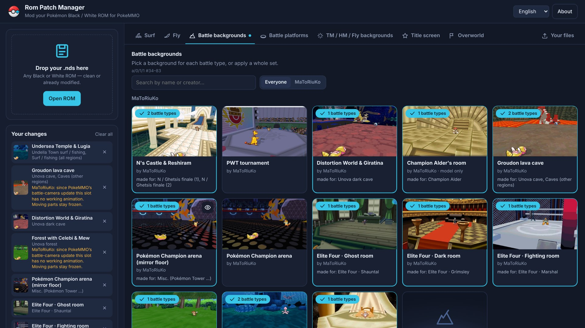
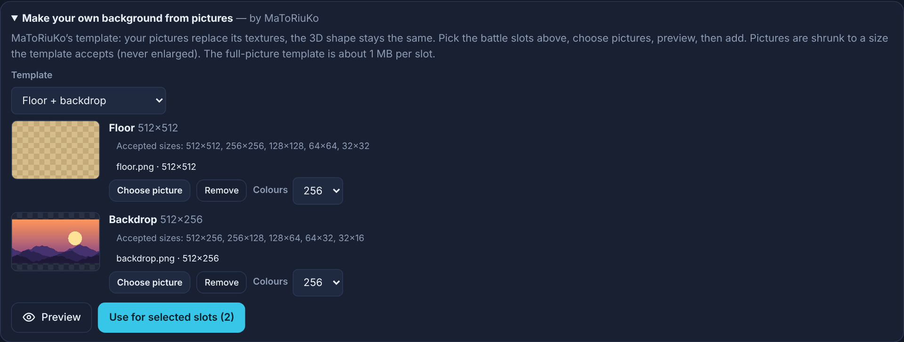
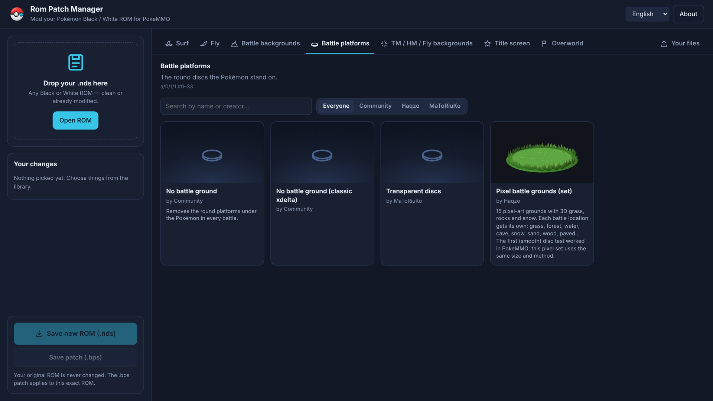
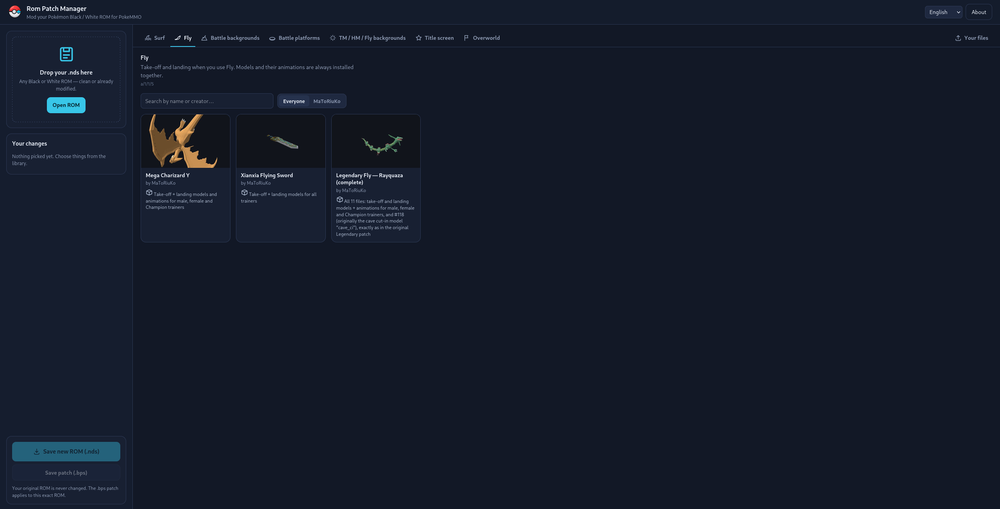
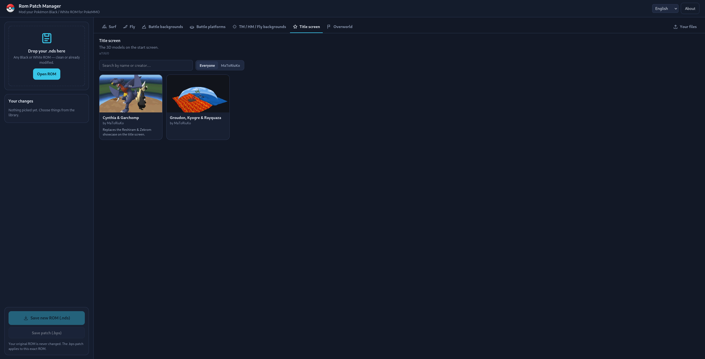
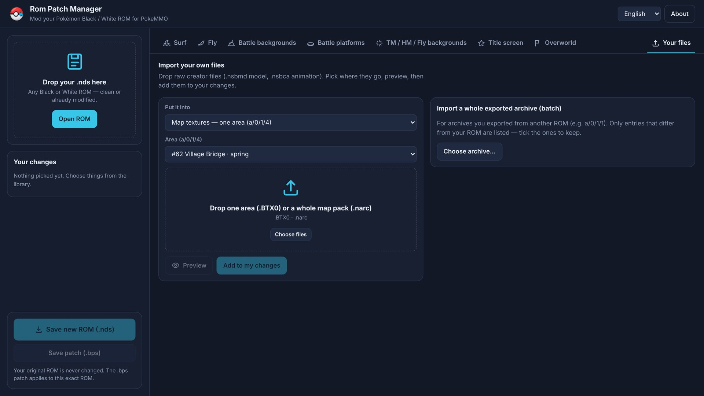
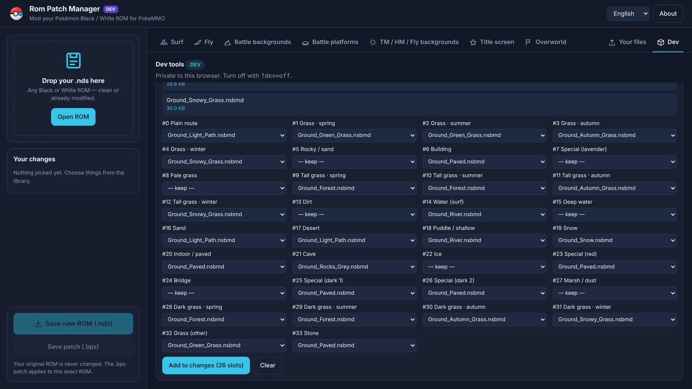
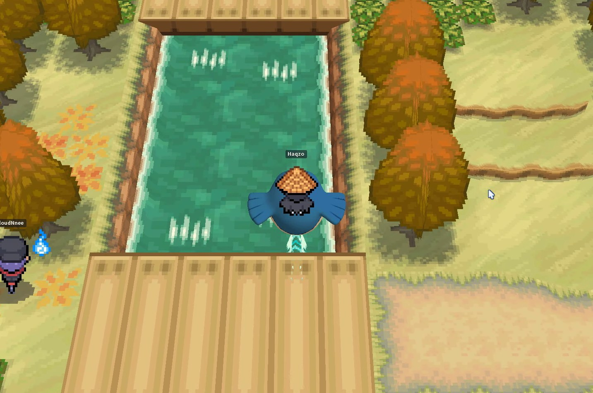

</details>

## How it works

- **Any Black or White ROM**, clean or already modified. Files are found through the ROM's own file table
  (`a/0/7/5`, `a/0/1/1`, `a/1/1/5` …). There is no list of allowed ROMs.
- **One choice = one complete feature.** Legendary Fly is one bundle of all 11 files; a battle scene keeps its model
  and skeletal animation together; Surf only ever touches `a/0/7/5 #49`.
- **3D previews:** free rotation, 4 views, animations, *compare with what's in your ROM*, export the raw model.
- **Export:** every replaced entry is read back after the build, and the `.bps` is re-applied to confirm it rebuilds
  the same ROM. Entries that keep their size (or shrink) are written in place.
- **Size meter**: warns above 25 MB of extra data (MaToRiuKo tested 24.8 MB loading fine in game).

## Making your own models

Read [docs/custom-models.md](docs/custom-models.md). Short version: convert with
`tools/model-pipeline/model2surf.py` (X/Y, Sun/Moon Poké Ride, Platinum, Scarlet/Violet models), export with
**CTRMap-CE** (textures: *High Color* + *Serialize as Lookup Table*), test in PokeMMO, then add it with
**Your files**. Never hand-write `.nsbmd` files — PokeMMO only accepts CTRMap-made ones.

## Repository

```
app/                 the whole tool = the website (static files; published by .github/workflows/pages.yml)
  core/rom.js        NDS / NARC / BPS
  core/plan.js       picks → writes, overlap + size checks, "what's installed" scan
  core/bgtemplate.js MaToRiuKo's battle-background template swap (port of romtool bgtemplate.py)
  core/nitro/        BMD0/BCA0/TEX0 parsing + posing (compiled from vendor-ts/)
  dev.js             dev mode (?dev): My items, packs, platform builder
  dev-library.js     dev mode: library / categories / presets editor, publishing
  core/edits.js      applies library-src/community/edits.json (site build + dev preview)
  viewer.js          WebGL preview
  i18n.js            English / 简体中文 / Español
  data/mapnames.json the 282 map-texture areas (from MaToRiuKo's romtool)
  library/           library.json + files/ (raw creator files) + previews/
library-src/community/  Haqzo's models, battle grounds and MaToRiuKo's templates (merged by scripts/add-community.mjs)
tools/model-pipeline/   model2surf.py, make-grounds.py and friends (see docs/custom-models.md)
screenshots/         release screenshots
tests/               automated checks (synthetic ROM + optional real-ROM builds)
docs/                custom models, dev mode, MaToRiuKo's resource notes
```

```bash
npm test                                                # library + logic + synthetic-ROM checks
ROM_MODIFIED=… ROM_EN=… ROM_ES=… ROM_WHITE=… npm test   # plus real-ROM builds (ROMs are never in the repo)
```

## Credits

- **MaToRiuKo** — models, battle backgrounds, the battle-background templates, map packages, resource research and
  the original romtool.
- **Haqzo** — the tool, the library, new Surf models and the pixel battle grounds (with Claude).
- **YOKA** — Blue PVP Battle Field (community upload).
- **CTRMap-CE** by HelloOO7 and contributors — the model exporter every working custom model goes through.
- Source models for the new Surf rides come from Pokémon X/Y and Sun/Moon via The Models Resource.
  Pokémon and all related models are © Nintendo / Game Freak / The Pokémon Company.

Only use creators' mods with their permission. No ROMs are included or distributed.
